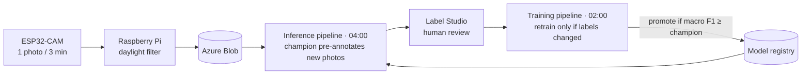
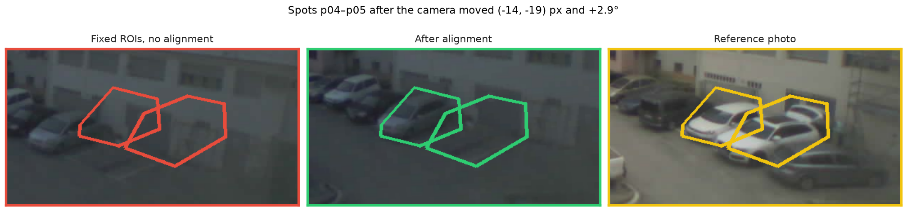

# ParkWatch

End-to-end MLOps system that tells which spots of a car park are free, from the photos of an ESP32-CAM. The whole loop runs on Azure ML every night: capture → pre-annotation by the model → human review in Label Studio → retraining → promotion of the best model.

**Stack:** ESP32-CAM · Raspberry Pi (FastAPI) · Azure Blob · Label Studio · Azure ML (pipelines, schedules, MLflow, model registry) · PyTorch · OpenCV · Bicep

## How it works

- **Model:** ParkNet, a custom CNN (~583 k parameters) trained from scratch that classifies each spot as `free` or `occupied`.
- **Data:** one crop per spot, defined by fixed polygons drawn once on a reference photo.
- **Evaluation:** cross-validation grouped by day, and a fixed holdout of whole days that no model ever sees.
- **Automation:** the training pipeline only retrains when the dataset fingerprint changes, and promotes the new model only if it matches or beats the current champion. Infrastructure as code (Bicep), managed identity, no keys, alert on failure.

## The camera moves

The camera is glued to a window, so it slowly drifts, and one day it fell and had to be glued back. With fixed polygons, the crops stop covering their spot: in the example below, spots p04–p05 end up on the wall.

**Fix:** every photo is aligned with the reference photo before cropping. Keypoints (SIFT) are matched on static parts of the scene, such as building facades, and a rotation + shift is estimated (RANSAC). The photo is then straightened, so the same polygons fit again. The same correction is applied in training and inference, and it also moves the polygons shown in Label Studio.

With alignment, cross-validation errors almost halved, and the model now performs the same on days with and without camera movement.

## Results

| Model | Cross-validation (macro F1) | Out-of-fold accuracy |
| --- | --- | --- |
| Without alignment | 0.935 ± 0.024 | 95.5 % |
| With alignment | **0.960 ± 0.005** | **97.6 %** |

## Repository

| Folder | Contents |
| --- | --- |
| `esp32_firmware/`, `pi_receiver/` | Capture: camera firmware and Raspberry Pi service |
| `ml/` | Pipeline steps: dataset, alignment, ParkNet, training, promotion, inference |
| `aml/` | Azure ML environments, components, pipelines and schedules |
| `infra/` | Azure infrastructure in Bicep |
| `label_studio/`, `tools/` | Labelling config, spot polygons and local tools |
| `plan.md` | Decision log |
