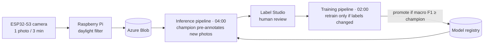

# ParkWatch

End-to-end MLOps system that tells which spots of a car park are free, from the photos of an ESP32 camera. The whole loop runs on Azure ML every night: capture → pre-annotation by the model → human review in Label Studio → retraining → promotion of the best model.

**Current model:** 97.2 % accuracy (macro F1 0.969) on whole days the model has never seen, trained on 28,000 labelled crops from 25 days of photos.

**Stack:** ESP32-S3 + OV5640 · Raspberry Pi (FastAPI) · Azure Blob · Label Studio · Azure ML (pipelines, schedules, model registry) · MLflow · PyTorch · OpenCV · Bicep

## How it works



## 1. Image capture

- **Camera:** a Freenove ESP32-S3-WROOM CAM board with an OV5640 sensor, glued to a window. The firmware knows nothing about schedules or light: it takes a photo every 3 minutes and POSTs the JPEG to a Raspberry Pi on the same network.
- **Raspberry Pi:** a small FastAPI service receives each photo, discards the ones taken at night (civil twilight ± 15 min, computed for the camera's location), straightens and resizes it to 1600 px, and uploads it to Azure Blob Storage, one folder per day. If the upload fails, the photo waits in a local spool and is retried.
- **Azure Blob:** the only source of photos for everything else. About 230 photos per day.

## 2. Image processing

### 2.1 The camera moves: landmark anchors

Each spot is a fixed polygon drawn once on a reference photo. But the camera is glued to a window: it drifts slowly, it gets knocked, and one day it fell and had to be glued back. With fixed polygons the crops stop covering their spot.

**Fix:** 15 fixed points of the scene (corners of buildings, windows) are clicked once on the reference photo. Every later photo is tracked from the previous one: each landmark is searched near where it was, and matches that disagree with the common movement are rejected. After a big movement, the landmarks are clicked again on one photo (an *anchor*) and the tracking restarts from there.

- The lens is a fisheye, so every part of the image moves differently: each spot gets its own correction, fitted to the landmarks around it.
- Dark photos give chance matches, so an implausible movement between two photos is rejected and the previous position is kept.
- If a spot jumps or the landmarks are lost in daylight, the pipeline sends an email with the photo to anchor.

At the anchors, the tracking arrives within 10 px of the clicks (mostly 1–6 px).


### 2.2 From photo to model input

For every spot, the photo is cropped to the bounding box of its polygon plus a 10 % margin, and letterboxed to a 96×96 square without stretching. The same code builds the crop in training, evaluation and inference. In training, the crops also get light colour changes and horizontal flips.


## 3. Review and labelling in Label Studio

Nobody labels from scratch. Every night the current best model (the *champion*) predicts the new photos and creates one Label Studio task per photo, with the five polygons already placed over their spots and coloured by the predicted label. The reviewer only fixes the wrong ones.

- **Three labels:** `free`, `occupied`, and `exclude` when the spot cannot be judged (too dark, fogged lens). Excluded crops are left out of the dataset.
- **Only the label is used.** Training always crops from the fixed polygons and the alignment, so moving a polygon by accident in Label Studio changes nothing.
- Each prediction carries the model's confidence, so the doubtful photos can be reviewed first.


## 4. Architecture

### 4.1 ParkNet

A small CNN trained from scratch that classifies one crop as `free` or `occupied`: four blocks of two 3×3 convolutions (32, 64, 128 and 128 filters) with batch normalisation and max pooling, then global average pooling, dropout and a linear layer. It has 583,000 parameters, small enough to retrain from scratch every night on one GPU.

### 4.2 Pipelines and experiment tracking

Two independent Azure ML pipelines, each on a nightly schedule:

| Pipeline | Steps |
| --- | --- |
| **Training** (02:00) | align photos → check whether the dataset changed → build dataset → train → evaluate and promote |
| **Inference** (04:00) | align photos → predict with the champion → create or update the Label Studio tasks |

- **Retraining only when needed.** A fingerprint of the labels, the polygons and the alignment decides whether the dataset changed. If it did not, the night ends after the alignment.
- **Promotion.** The new model replaces the champion only if it matches or beats its macro F1 on the holdout, both evaluated on the same crops.
- **MLflow.** Every training logs its parameters, metrics, confusion matrix and error sheets to a self-hosted MLflow server, together with the comparison against the champion and the decision. Models live in the Azure ML registry, where one version carries the `champion` tag.

### 4.3 Compute

| Cluster | VM | Used for |
| --- | --- | --- |
| CPU | Standard_D4as_v4 (4 vCPU) | alignment, dataset, inference, promotion |
| GPU | Standard_NC4as_T4_v3 (one NVIDIA T4) | training |

Both clusters scale to zero, and so does the MLflow server: there is only a cost while a pipeline runs. The infrastructure is defined in Bicep, and the jobs reach storage, Key Vault and Label Studio with a managed identity, without keys in the code.

## 5. Evaluation and results

- **Holdout:** whole days that no model ever trains on, chosen by hand. A day that goes in never comes out. Splitting by days matters: photos three minutes apart are almost identical, so a random split would leak.
- **Cross-validation:** four folds grouped by day, run weekly, to choose the number of epochs and to compare experiments without touching the holdout.
- **Metric:** macro F1 over `free` and `occupied`.

Champion (`parknet:11`) on the two holdout days labelled so far (23 Oct and 3 Nov, 2,329 crops; 3 Nov is a day with the camera moved):

| | Accuracy | Crops |
| --- | --- | --- |
| **All spots** | **97.2 %** (macro F1 0.969) | 2,329 |
| p01 | 97.3 % | 490 |
| p02 | 100 % | 479 |
| p03 | 96.3 % | 481 |
| p04 | 92.3 % | 441 |
| p05 | 99.8 % | 438 |

| Image quality | Accuracy | Crops |
| --- | --- | --- |
| Good | 97.7 % | 1,556 |
| Low contrast | 96.4 % | 523 |
| Dark | 95.6 % | 250 |

**Known limitations**

- **p04** is the hardest spot: vehicles parked in the neighbouring spots enter its crop.
- **Dusk and dawn:** dark photos fail more than daylight ones.
- **Rare cases:** hard shadows across a spot, and vehicles the model has seen few times (vans seen from above).

## Repository

| Folder | Contents |
| --- | --- |
| `esp32_firmware/`, `pi_receiver/` | Capture: camera firmware and Raspberry Pi service |
| `ml/` | Pipeline steps: alignment, dataset, ParkNet, training, promotion, inference |
| `aml/` | Azure ML environments, components, pipelines and schedules |
| `infra/` | Azure infrastructure in Bicep |
| `label_studio/`, `tools/` | Labelling config, spot polygons and local tools |
| `plan.md` | Decision log |

Run from the repo root, with `az login`:

```bash
uv run python aml/pipelines/training.py      # training pipeline (retrains if the dataset changed)
uv run python aml/pipelines/inference.py     # inference pipeline (pre-annotates the last days)
uv run python aml/pipelines/schedules.py     # creates or updates the nightly schedules
```
