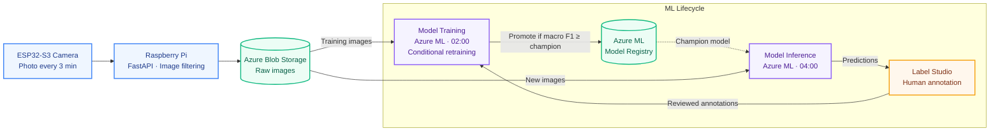

# ParkWatch

End-to-end MLOps system that tells you which spots in a car park are free, using photos from an ESP32 camera. The whole loop runs by itself every night on Azure ML: the camera captures, the model pre-annotates, I review the labels in Label Studio, it retrains, and the best model gets promoted.

*Current model*: 97.2% accurate (macro F1 0.969) on entire days it has never seen. I trained it on 28,000 labelled crops from 25 days of photos.

*Stack*: ESP32-S3 + OV5640 · Raspberry Pi (FastAPI) · Azure Blob · Label Studio · Azure ML (pipelines, schedules, model registry) · MLflow · PyTorch · OpenCV · Bicep

## How it works



## 1. Image capture

The camera is a [Freenove ESP32-S3-WROOM CAM board](https://www.amazon.es/dp/B0F48DV38M) with an [OV5640 sensor](https://es.aliexpress.com/item/1005006858943975.html), glued to a window that looks over the car park. I kept its firmware as simple as I could: it takes a photo every 3 minutes and sends it to a Raspberry Pi on the same network. It doesn't know what time it is or whether it's dark outside.

The Raspberry Pi does the thinking. A small FastAPI service receives each photo and throws away the ones taken at night, using the civil twilight times for the camera's location with a 15-minute margin. The photos that pass are rotated, resized to 1600 px and uploaded to Azure Blob Storage. If the upload fails, the photo stays on the Pi and it tries again later, so a Wi-Fi cut doesn't lose anything.

Azure Blob Storage is where everything else starts. Photos are stored in one folder per day, about 230 a day, and both pipelines read from there: training takes the labelled photos and inference takes the new ones.

## 2. Image processing

### 2.1 From photo to model input

The model never looks at the whole photo. I drew one polygon per parking spot on a reference photo, and every photo is cut into five small images, one per spot. Each crop is the box around the polygon plus a 10 % margin, placed on a 96×96 square without stretching it.


The same code makes the crops for training, evaluation and inference, so the model always sees exactly what it was trained on. During training I also add small colour changes and horizontal flips, so that it doesn't memorise the exact photos.

### 2.2 The camera moves: landmark anchors

Polygons drawn once would be enough if the camera never moved, but it is glued to a window. It drifts a little every day, it gets knocked when someone opens the window, and once it fell off and I had to glue it back. After that, the polygons no longer sat on their spots.

To fix it, I picked 15 points of the scene that never move, like the corners of buildings and windows, and clicked them once on the reference photo. For every new photo, the pipeline looks for each point close to where it was in the previous photo, and drops the matches that don't agree with how the others moved. From those points it works out where each spot is now. When the camera moves a lot, I click the points again on one photo, which I call an anchor, and the tracking carries on from there.


Because the lens is a fisheye, the image doesn't move the same amount everywhere, so each spot gets its own correction from the landmarks closest to it. Checked against the anchors, the tracking lands within 10 px of my clicks, and usually within 1 to 6 px.

## 3. Review and labelling in Label Studio

Nobody labels from scratch. Every night the current best model (the *champion*) predicts the new photos and creates one Label Studio task per photo, with the five polygons already placed over their spots and coloured by the predicted label. The reviewer only fixes the wrong ones.

- **Three labels:** `free`, `occupied`, and `exclude` when the spot cannot be judged (too dark, fogged lens). Excluded crops are left out of the dataset.
- **Only the label is used.** Training always crops from the fixed polygons and the alignment, so moving a polygon by accident in Label Studio changes nothing.
- Each prediction carries the model's confidence, so the doubtful photos can be reviewed first.


## 4. Architecture

### 4.1 ParkNet

A small CNN trained from scratch that classifies one crop as `free` or `occupied`: four blocks of two 3×3 convolutions (32, 64, 128 and 128 filters) with batch normalisation and max pooling, then global average pooling, dropout and a linear layer. It has 583,000 parameters, small enough to retrain from scratch every night on one GPU.

### 4.2 Pipelines and experiment tracking

Two independent Azure ML pipelines, each on a nightly schedule:

| Pipeline | Steps |
| --- | --- |
| **Training** (02:00) | align photos → check whether the dataset changed → build dataset → train → evaluate and promote |
| **Inference** (04:00) | align photos → predict with the champion → create or update the Label Studio tasks |

- **Retraining only when needed.** A fingerprint of the labels, the polygons and the alignment decides whether the dataset changed. If it did not, the night ends after the alignment.
- **Promotion.** The new model replaces the champion only if it matches or beats its macro F1 on the holdout, both evaluated on the same crops.
- **MLflow.** Every training logs its parameters, metrics, confusion matrix and error sheets to a self-hosted MLflow server, together with the comparison against the champion and the decision. Models live in the Azure ML registry, where one version carries the `champion` tag.

### 4.3 Compute

| Cluster | VM | Used for |
| --- | --- | --- |
| CPU | Standard_D4as_v4 (4 vCPU) | alignment, dataset, inference, promotion |
| GPU | Standard_NC4as_T4_v3 (one NVIDIA T4) | training |

Both clusters scale to zero, and so does the MLflow server: there is only a cost while a pipeline runs. The infrastructure is defined in Bicep, and the jobs reach storage, Key Vault and Label Studio with a managed identity, without keys in the code.

## 5. Evaluation and results

- **Holdout:** whole days that no model ever trains on, chosen by hand. A day that goes in never comes out. Splitting by days matters: photos three minutes apart are almost identical, so a random split would leak.
- **Cross-validation:** four folds grouped by day, run weekly, to choose the number of epochs and to compare experiments without touching the holdout.
- **Metric:** macro F1 over `free` and `occupied`.

Champion (`parknet:11`) on the two holdout days labelled so far (23 Oct and 3 Nov, 2,329 crops; 3 Nov is a day with the camera moved):

| | Accuracy | Crops |
| --- | --- | --- |
| **All spots** | **97.2 %** (macro F1 0.969) | 2,329 |
| p01 | 97.3 % | 490 |
| p02 | 100 % | 479 |
| p03 | 96.3 % | 481 |
| p04 | 92.3 % | 441 |
| p05 | 99.8 % | 438 |

| Image quality | Accuracy | Crops |
| --- | --- | --- |
| Good | 97.7 % | 1,556 |
| Low contrast | 96.4 % | 523 |
| Dark | 95.6 % | 250 |

**Known limitations**

- **p04** is the hardest spot: vehicles parked in the neighbouring spots enter its crop.
- **Dusk and dawn:** dark photos fail more than daylight ones.
- **Rare cases:** hard shadows across a spot, and vehicles the model has seen few times (vans seen from above).

## Repository

| Folder | Contents |
| --- | --- |
| `esp32_firmware/`, `pi_receiver/` | Capture: camera firmware and Raspberry Pi service |
| `ml/` | Pipeline steps: alignment, dataset, ParkNet, training, promotion, inference |
| `aml/` | Azure ML environments, components, pipelines and schedules |
| `infra/` | Azure infrastructure in Bicep |
| `label_studio/`, `tools/` | Labelling config, spot polygons and local tools |
| `plan.md` | Decision log |

Run from the repo root, with `az login`:

```bash
uv run python aml/pipelines/training.py      # training pipeline (retrains if the dataset changed)
uv run python aml/pipelines/inference.py     # inference pipeline (pre-annotates the last days)
uv run python aml/pipelines/schedules.py     # creates or updates the nightly schedules
```
