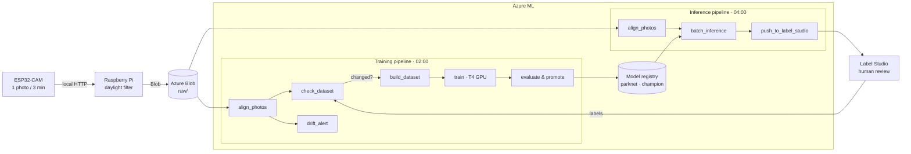

# ParkWatch

End-to-end MLOps system that detects which spots of a car park are free from the photos of an ESP32-CAM camera. The whole loop is automated on Azure: capture, pre-annotation by the model, human review in Label Studio, nightly retraining, promotion of the best model, and back again.

The model, **ParkNet**, is a custom CNN of ~583 k parameters trained from scratch (no transfer learning) that classifies each spot as `free` or `occupied`.

## Architecture



- **Capture:** the ESP32-CAM sends a photo every 3 minutes to the Raspberry Pi, which drops the ones taken outside daylight and uploads the rest to Azure Blob.
- **Pre-annotation:** every night the `champion` model predicts the new photos and creates the Label Studio tasks with its predictions, each polygon placed over its real spot.
- **Review:** in the morning only the spots the model got wrong are corrected in Label Studio.
- **Retraining:** every night, but only if the labels changed. The dataset is rebuilt, a model is trained, and it is promoted to `champion` if it matches or beats the current one's macro F1 on a fixed holdout.

## Design decisions

| Topic | Decision |
| --- | --- |
| Model | Custom CNN, 4 conv + BN + ReLU blocks, 96 × 96 px, class-weighted cross-entropy, AdamW and cosine schedule |
| Examples | One crop per spot: the bounding box of the `rois.json` polygon + 10 % margin, letterboxed to a square |
| Validation | Cross-validation grouped by day (4 folds), which picks the number of epochs |
| Holdout | Whole days chosen by hand and fixed, never seen by any model: 23/10 (the most varied) and 3/11 (camera moved) |
| Promotion | Macro F1 on the holdout; the new model is promoted if it matches or beats the champion. `champion` = a tag on the model version (the Azure ML registry does not support MLflow aliases) |
| Retraining | Only if the dataset **fingerprint** changes (labels, ROIs, margins and alignment). The branch is skipped with a conditional pipeline node |
| Camera drift | The camera is glued in place and moves. Every photo is aligned with the reference one (SIFT + RANSAC on static regions) and straightened before cropping, the same way in training and inference |
| Infrastructure | Everything in Bicep (`infra/`). Managed identity without keys, secrets in Key Vault, CPU and GPU clusters that scale to zero |
| Alerts | Azure Monitor alert on failed runs, and a step that fails on purpose if the camera has moved too much |

## Results

| Model | Cross-validation (macro F1) | Out-of-fold accuracy | Holdout 23/10 (macro F1) |
| --- | --- | --- | --- |
| `parknet:1`, unaligned crops | 0.935 ± 0.024 | 95.5 % | 0.966 |
| Aligned crops | 0.960 ± 0.005 | 97.6 % | 0.962 |

With alignment, out-of-fold errors almost halve (from 4.5 % to 2.4 %) and performance becomes the same across all groups of days, including those where the camera had moved. A single-day holdout with little drift does not capture that gain, which is why 3/11 was added to the holdout.

## Repository layout

| Folder | Contents |
| --- | --- |
| `esp32_firmware/` | Capture firmware for the ESP32-CAM |
| `pi_receiver/` | FastAPI service on the Raspberry Pi: receives the photos, filters by daylight and uploads to Blob |
| `label_studio/` | Labelling config, spot ROIs (`rois.json`) and static regions (`static_mask.json`) |
| `ml/` | Code of the pipeline steps: dataset, alignment, ParkNet, training, promotion and inference |
| `aml/` | Azure ML environments, components, pipelines and schedules |
| `infra/` | Bicep: workspace, Storage, Key Vault, identity, roles, clusters, registry and alerts |
| `tools/` | Local tools: ROIs and mask from Label Studio, camera drift measurement, alignment previews and per-day statistics to choose the holdout |
| `plan.md` | Decision log of the project |

## Usage

Requirements: [uv](https://docs.astral.sh/uv/), the Azure CLI with the `ml` extension, and `az login`.

```powershell
uv sync

# Infrastructure
az deployment group create -g parkwatch -f infra/main.bicep -p userObjectId=<id> alertEmail=<email>

# Pipelines, submitted by hand
uv run python aml/pipelines/training.py              # retrains if the dataset changed
uv run python aml/pipelines/training.py --run-cv     # with full cross-validation
uv run python aml/pipelines/inference.py --days 2026-11-03

# Schedules (02:00 training, Mondays with CV, 04:00 inference)
uv run python aml/pipelines/schedules.py

# Camera drift
uv run python tools/camera_drift.py --mask label_studio/static_mask.json
uv run python tools/alignment_preview.py --days 2026-11-03
```

Secrets live in local `.env` files that are never committed; there are `.env.example` templates in `tools/` and `pi_receiver/`.
