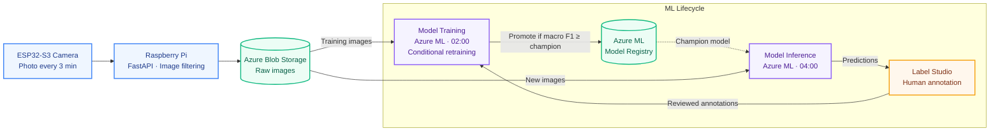
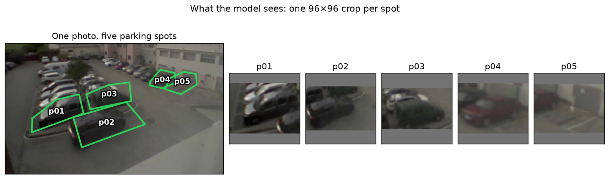
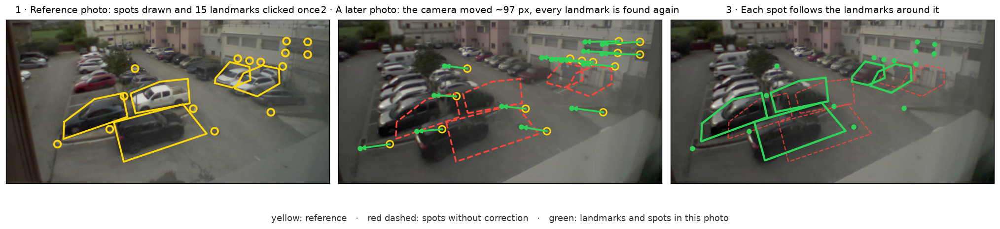
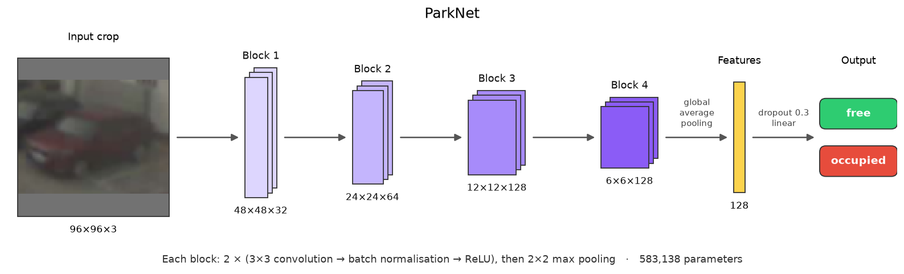
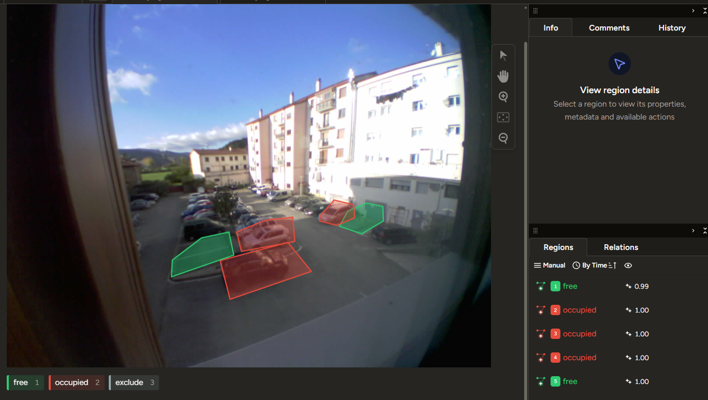

# ParkWatch

End-to-end MLOps system that tells you which spots in a car park are free, using photos from an ESP32 camera. The whole loop runs by itself every night on Azure ML: the camera captures, the model pre-annotates, I review the labels in Label Studio, it retrains, and the best model gets promoted.

*Current model*: 97.2% accurate (macro F1 0.969) on entire days it has never seen. I trained it on 28,000 labelled crops from 25 days of photos.

*Stack*: ESP32-S3 + OV5640 · Raspberry Pi (FastAPI) · Azure Blob · Label Studio · Azure ML (pipelines, schedules, model registry) · MLflow · PyTorch · OpenCV · Bicep

## How it works



## 1. Image capture

The camera is a [Freenove ESP32-S3-WROOM CAM board](https://www.amazon.es/dp/B0F48DV38M) with an [OV5640 sensor](https://es.aliexpress.com/item/1005006858943975.html), glued to a window that looks over the car park. I kept its firmware as simple as I could: it takes a photo every 3 minutes and sends it to a Raspberry Pi on the same network. It doesn't know what time it is or whether it's dark outside.

The Raspberry Pi does the thinking. A small FastAPI service receives each photo and throws away the ones taken at night, using the civil twilight times for the camera's location with a 15-minute margin. The photos that pass are rotated, resized to 1600 px and uploaded to Azure Blob Storage. If the upload fails, the photo stays on the Pi and it tries again later, so a Wi-Fi cut doesn't lose anything.

Azure Blob Storage is where everything else starts. Photos are stored in one folder per day, about 230 a day, and both pipelines read from there: training takes the labelled photos and inference takes the new ones.

## 2. Image processing

### 2.1 From photo to model input

The model never looks at the whole photo. I drew one polygon per parking spot on a reference photo, and every photo is cut into five small images, one per spot. Each crop is the box around the polygon plus a 10 % margin, placed on a 96×96 square without stretching it.



The same code makes the crops for training, evaluation and inference, so the model always sees exactly what it was trained on. During training I also add small colour changes and horizontal flips, so that it doesn't memorise the exact photos.

### 2.2 The camera moves: landmark anchors

Polygons drawn once would be enough if the camera never moved, but it is glued to a window. It drifts a little every day, it gets knocked when someone opens the window, and once it fell off and I had to glue it back. After that, the polygons no longer sat on their spots.

To fix it, I picked 15 points of the scene that never move, like the corners of buildings and windows, and clicked them once on the reference photo. For every new photo, the pipeline looks for each point close to where it was in the previous photo, and drops the matches that don't agree with how the others moved. From those points it works out where each spot is now. When the camera moves a lot, I click the points again on one photo, which I call an anchor, and the tracking carries on from there.



Because the lens is a fisheye, the image doesn't move the same amount everywhere, so each spot gets its own correction from the landmarks closest to it. Checked against the anchors, the tracking lands within 10 px of my clicks, and usually within 1 to 6 px.

## 3. The ML lifecycle

Once the photos are in Blob Storage, the rest is a loop that repeats every night. A model is trained, the best one predicts the new photos, I correct its mistakes, and those corrections feed the next training.

### 3.1 Training ParkNet

The model is ParkNet, a small convolutional network that I built for this problem and train from scratch. It takes one 96×96 crop and answers `free` or `occupied`.



Each block halves the size of the image and looks for more complex patterns than the one before. In total it has 583,000 parameters, small enough to retrain from scratch every night on a single GPU.

The training pipeline starts every night at 02:00. Before training, it checks whether anything has changed since the last run: the labels I corrected, the polygons of the spots or the alignment of the photos. If nothing has changed, the model would come out the same, so it stops there.

Once a week it does a longer run to check how well the model generalises. It splits the days into four groups, trains four times leaving one group out each time, and tests each model on the days it didn't see. I use those results to decide how long to train and to compare new ideas.

Every training logs its parameters, metrics, confusion matrix and images of its errors to MLflow, so I can look at what failed and not only at the score.

### 3.2 Model registry: promoting the champion

A new model doesn't go into use just because it is new. It is compared with the current best model, the *champion*, on the same holdout: whole days that no model has ever trained on. The new model takes the champion's place only if it scores at least as well.

The score I use is macro F1, not accuracy. The car park is full most of the time, so only about one in five crops shows a free spot. A model that answered "occupied" almost always would still get a high accuracy, and it would be useless, because the free spots are exactly what I want to find. Macro F1 gives the same weight to `free` and `occupied`, however many examples each one has, so a model has to be good at both to score well.

Every version is kept in the Azure ML model registry, and one of them carries the `champion` tag.

### 3.3 Inference

At 04:00, two hours after the training, the inference pipeline runs. If a new model was promoted that night, this is the first time it is used.

It takes the champion and predicts every spot in the photos of the last three days. Before predicting, it works out where each spot is in each photo, with the landmark alignment from section 2.2, so the model looks at the right place even if the camera moved that day.

The results go to Label Studio as one task per photo, with the five polygons already in place and coloured by the prediction. Each one carries the model's confidence, so I can go straight to the photos it wasn't sure about. Tasks that I have already reviewed are never touched: the pipeline only fills in the ones that are still waiting.

### 3.4 Review in Label Studio

This is the only manual step, and the reason the model keeps improving. Every morning the photos of the day before are waiting in Label Studio with the model's answer on each spot. I don't label from scratch: I go through them and fix only the spots it got wrong.



There are three labels. `free` and `occupied` are what the model learns. `exclude` is for the spots I can't judge myself, for example when it is too dark or the lens is fogged, and those are left out of the dataset. I would rather lose a photo than teach the model something I'm not sure about.

Only the label matters. Training always cuts the crops from its own polygons, so moving a polygon by accident in Label Studio changes nothing.

My corrections change the dataset, the next training at 02:00 picks them up, and the loop starts again.

## 4. Infrastructure

Everything runs on Azure, and I set it up so that it costs money only while something is running.

| What | Where it runs | Used for |
| --- | --- | --- |
| CPU cluster | Standard_D4as_v4 (4 vCPU) | alignment, dataset, inference, promotion |
| GPU cluster | Standard_NC4as_T4_v3 (one NVIDIA T4) | training |
| Label Studio | Azure Container App | reviewing the labels |
| MLflow | Azure Container App | tracking every training |

The two clusters have between zero and one machine. A machine starts when a pipeline needs it and is released when the pipeline finishes, so most of the day nothing is running. The MLflow server does the same: it sleeps until a training or I need it.

The pipelines are two Azure ML schedules, one for training and one for inference. If a step fails, or the camera alignment raises an alert, Azure sends me an email.

## 5. Results

The numbers below come from the holdout: whole days set apart that no model ever trains on. I split by days and not by photos because two photos taken three minutes apart are almost the same picture, so a random split would make the model look better than it is.

The current champion gets **97.2 % of the spots right** (macro F1 0.969).

| Spot | Accuracy | Crops |
| --- | --- | --- |
| p01 | 97.3 % | 490 |
| p02 | 100 % | 479 |
| p03 | 96.3 % | 481 |
| p04 | 92.3 % | 441 |
| p05 | 99.8 % | 438 |

| Image quality | Accuracy | Crops |
| --- | --- | --- |
| Good | 97.7 % | 1,556 |
| Low contrast | 96.4 % | 523 |
| Dark | 95.6 % | 250 |

## Repository

| Folder | What's inside |
| --- | --- |
| `esp32_firmware/` | The camera firmware |
| `pi_receiver/` | The service on the Raspberry Pi that filters and uploads the photos |
| `ml/` | Every step of the pipelines: alignment, dataset, ParkNet, training, promotion and inference |
| `aml/` | The Azure ML side: environments, components, pipelines and schedules |
| `infra/` | The Azure infrastructure, written in Bicep |
| `label_studio/` | The labelling setup and the polygons of the spots |
| `tools/` | Scripts I run on my laptop: reviewing errors, previewing crops, creating anchor tasks, the README figures |
| `docs/images/` | The images of this README |
| `plan.md` | My decision log: what I tried, what worked and why I chose each thing |

To launch the pipelines by hand, from the repo root and after `az login`:

```bash
uv run python aml/pipelines/training.py      # retrains if the labels changed
uv run python aml/pipelines/inference.py     # predicts the last days and updates Label Studio
uv run python aml/pipelines/schedules.py     # creates or updates the nightly schedules
```
